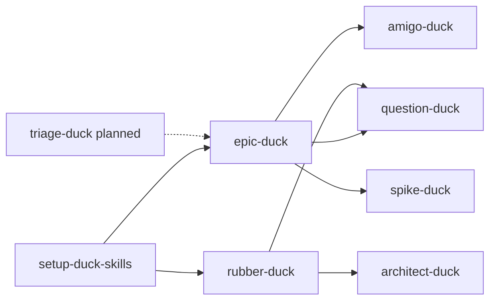

Spike: [0003-spike-skill-inventory.md](../items/0003-spike-skill-inventory.md)

# Skill inventory v2.1 (post–ADR 0001)

**Version:** v2.1 — re-reads all in-scope `SKILL.md` files and `docs/agents/*`, `docs/adr/0001-backlog-ticket-shapes.md`, `AGENTS.md`, and `README.md`. v1 remains unchanged at [0003-skill-inventory.md](./0003-skill-inventory.md).

## TLDR

Seven skills exist under `.cursor/skills/`; **`triage-duck` is not implemented** (plan [0001](../items/0001-plan-duck-skills-planning-refinement.md), decision [0006](../items/0006-decision-triage-duck-activation.md), task [0010](../items/0010-implement-triage-duck.md)). After **ADR 0001** and `docs/agents/backlog.md`, local backlog shapes are aligned: first-line **`Type: epic-duck:*`**, unified **`Status:`**, spike items are typed, findings files use `Spike:` + **`## TLDR`** only.

**Artefact ownership:** **`setup-duck-skills`** seeds tracker and domain layout (and optional remote labels). **`epic-duck`** is the primary writer for plans and child items under `.backlog/`. **`spike-duck`** writes spike findings (and may create spike items when none exist). **`rubber-duck`** skill text limits writes to **glossary/ADR**; **`amigo-duck`** produces in-chat reviews (`## amigo-duck review`) and does not publish by itself. **`question-duck`** and **`architect-duck`** have no mandated file writes in their skill text.

**Largest contradictions (v2.1):** Resolved decision [0004](../items/0004-decision-planning-pipeline-choreography.md) says **rubber-duck** may create backlog children on a **confirmed** feature (with **amigo-duck** before publish) and **epic-duck** may invoke **architect-duck** / delegate to **rubber-duck** — but **`rubber-duck/SKILL.md` and `epic-duck/SKILL.md` do not say this** ([0013](../items/0013-decision-skill-usage-eval-scenarios.md) follow-up). **README** still shows `rubber-duck` → backlog **tickets** while the rubber skill omits backlog writes. Plan **Notes** claim epic-duck uses **architect-duck**; epic skill text does not.

Sources: `.cursor/skills/*/SKILL.md`, `docs/agents/backlog.md`, `docs/agents/domain.md`, `docs/agents/ticket-statuses.md`, `docs/adr/0001-backlog-ticket-shapes.md`, `AGENTS.md`, `README.md`, `.backlog/items/0004-decision-planning-pipeline-choreography.md`.

---

## In-scope skills (presence and invocation)

| Skill | In repo | Explicit skill invocations (per `SKILL.md`) | Implicit / process |
|-------|---------|-----------------------------------------------|-------------------|
| setup-duck-skills | Yes | None | — |
| epic-duck | Yes | `question-duck`, `amigo-duck`, `spike-duck` | Subagents not named |
| rubber-duck | Yes | `question-duck`, `architect-duck` (apply both in one session) | — |
| question-duck | Yes | Subagents for facts only | — |
| architect-duck | Yes | None | — |
| amigo-duck | Yes | None | Invoked by epic-duck (and per 0004, by rubber when publishing) |
| spike-duck | Yes | Background agent for investigation | — |
| triage-duck | **No** | — (see [Planned: triage-duck](#planned-triage-duck)) | — |

**Not in scope but present:** `.cursor/skills/amigo-pato/` (separate skill; ignore unless plan expands scope).

---

## Per-skill: reads, writes, labels, backlog, domain

### setup-duck-skills

| Area | Detail |
|------|--------|
| **Reads** | `git remote` / `.git/config`, `AGENTS.md` / `CLAUDE.md`, `GLOSSARY.md`, `GLOSSARY-MAP.md`, `docs/adr/`, `docs/agents/`, `.backlog/`, monorepo signals |
| **Writes** | `docs/agents/backlog.md`, `docs/agents/domain.md`, `docs/agents/ticket-statuses.md` (if defaults accepted), `AGENTS.md` or `CLAUDE.md` (`## Agent skills` block), `.backlog/features.md` when local tracker chosen; custom `backlog.md` from user description |
| **Labels (remote)** | On GitHub/GitLab: create labels for each default **`Status:`** string and **`epic-duck:*`** types if missing |
| **Backlog** | Seeds operational doc; empty feature index for local mode — does not create plan/child items |
| **Domain** | Seeds `domain.md`; does not author glossary/ADR body |
| **Invokes** | None |
| **Consumers (listed at end of skill)** | `epic-duck`, `rubber-duck`, `question-duck`, `architect-duck`, `amigo-duck`, `spike-duck` — **not** `triage-duck` |

Source: `.cursor/skills/setup-duck-skills/SKILL.md`, seed templates under `.cursor/skills/setup-duck-skills/`.

---

### epic-duck

| Area | Detail |
|------|--------|
| **Reads** | `docs/agents/backlog.md` (incl. Epic-duck operations), `.backlog/features.md`, plan and child files under `.backlog/items/`, `docs/agents/ticket-statuses.md`; `git status` / diff vs `HEAD` on feature file (local, once per session before writes) |
| **Writes** | `.backlog/items/*` (plans, decisions, tasks, spike items), `.backlog/features.md`, plan sections and **Decisions** / **Tasks** / **Spikes** tables; decision `## Answer`; blocker sweeps on `Blocked by:`; spike **findings** delegated to **spike-duck** (not authored inline in epic skill) |
| **Labels** | Skill prose: plan “labelled `epic-duck:plan`” — on **local** markdown, equivalent is **`Type: epic-duck:plan`** + `features.md` + `*-plan-*.md` (`docs/agents/backlog.md`) |
| **Backlog** | Primary planner/publisher for feature charting and child lifecycle |
| **Domain** | Skill text: **no** glossary/ADR updates (domain work is rubber/architect per 0004, but **not** stated in epic `SKILL.md`) |
| **Invokes** | **`question-duck`** (plan creation, charting destination, resolving decisions), **`amigo-duck`** (before publish; all ticket types), **`spike-duck`** (spike children) |

Source: `.cursor/skills/epic-duck/SKILL.md`.

---

### rubber-duck

| Area | Detail |
|------|--------|
| **Reads** | `docs/agents/domain.md` (required; else prompt `/setup-duck-skills`) |
| **Writes (skill text)** | **`GLOSSARY.md`**, **`docs/adr/*`** via **architect-duck** behaviour — **no** `.backlog/` paths in skill |
| **Writes (decision 0004)** | May create **decisions, tasks, spike items** on an **existing** feature after user confirms plan; **amigo-duck** before publish — **not** in `SKILL.md` |
| **Labels** | None in skill |
| **Backlog** | Skill: none. 0004: children on confirmed feature only; **no** new plans |
| **Domain** | Primary user-facing session for glossary + ADR |
| **Invokes** | **`question-duck`**, **`architect-duck`** (both every session) |

Source: `.cursor/skills/rubber-duck/SKILL.md`; intended backlog behaviour: `.backlog/items/0004-decision-planning-pipeline-choreography.md` § Answer.

---

### question-duck

| Area | Detail |
|------|--------|
| **Reads** | Repo via subagents (filesystem, docs, tooling); no fixed paths |
| **Writes** | None in skill (conversation until another skill publishes) |
| **Labels** | None |
| **Backlog** | None |
| **Domain** | None |
| **Invokes** | Subagents for facts only |

Source: `.cursor/skills/question-duck/SKILL.md`.

---

### architect-duck

| Area | Detail |
|------|--------|
| **Reads** | `docs/agents/domain.md`, `GLOSSARY.md`, `GLOSSARY-MAP.md`, `docs/adr/`, code for cross-check |
| **Writes** | `GLOSSARY.md` (lazy create), `docs/adr/*.md` (lazy create); formats in `GLOSSARY-FORMAT.md`, `ADR-FORMAT.md` |
| **Labels** | None |
| **Backlog** | None |
| **Domain** | Glossary + ADR authoring |
| **Invokes** | None |

Source: `.cursor/skills/architect-duck/SKILL.md`.

---

### amigo-duck

| Area | Detail |
|------|--------|
| **Reads** | User intent + draft ticket (title, description, AC or epic shapes: `Type: epic-duck:decision` / `task` / `spike`); points reviewers to **`GLOSSARY.md`** for terms |
| **Writes** | **In-chat** review under **`## amigo-duck review`**; optional **Revised ticket** block — publish is separate (caller or user) |
| **Labels** | Describes remote **`epic-duck:*`** types in INVEST section; local files use **`Type:`** first line (ADR 0001) |
| **Backlog** | Gate before publish (`docs/agents/backlog.md`); does not define tracker layout |
| **Domain** | None (may reference glossary in criteria) |
| **Invokes** | None |

Source: `.cursor/skills/amigo-duck/SKILL.md`, ADR 0001 § Quality gates.

---

### spike-duck

| Area | Detail |
|------|--------|
| **Reads** | Primary sources per question; `docs/agents/backlog.md` for paths |
| **Writes** | `.backlog/spike/<NNNN>-<slug>.md` (findings: `Spike:` link, **`## TLDR`**, citations); may create `.backlog/items/<NNNN>-spike-<slug>.md` when allocating a new spike item; sets spike item **`Status: resolved`** when complete; may update parent plan **Spikes** / **Decisions so far** when epic-duck expects |
| **Labels** | None |
| **Backlog** | Spike item + findings; findings have **no** `Type:` or `Status:` |
| **Domain** | None |
| **Invokes** | Background agent (investigation) |

Source: `.cursor/skills/spike-duck/SKILL.md`, `docs/agents/backlog.md` § Spike item / findings.

---

### Planned: triage-duck

| Area | Detail (from backlog decisions, not skill file) |
|------|--------------------------------------------------|
| **Reads (expected)** | Backlog items (`Status:`, headers), `docs/agents/ticket-statuses.md`, likely `docs/agents/backlog.md` and feature index |
| **Writes (expected)** | **`Status:`** transitions (`needs-triage`, `needs-detail`, `ready`, `wontfix`, etc.); possibly `## Comments` — exact rules pending **0006** |
| **Labels** | Remote: same status strings as setup seeds; local: **`Status:`** field only |
| **Activation (open)** | User-only vs callable from planning skills — **0006** |
| **Relation to amigo-duck** | 0006: must clarify who sets **`Status: ready`** and order vs amigo-duck |
| **ADR 0001** | Triage should assume **unified `Status:`** only (no separate `Label: ready`) |

Sources: `.backlog/items/0006-decision-triage-duck-activation.md`, `docs/adr/0001-backlog-ticket-shapes.md`, `docs/agents/ticket-statuses.md`.

---

## Invocation graph (as coded in skills + 0004 intent)

Solid edges: stated in `SKILL.md`. Dotted: 0006 option 2 only. **0004** adds edges **not** in skill files: `epic --> arch`, `epic --> rubber`, `rubber --> amigo`, `rubber --> backlog items`.

---

## Contradictions and drift (v2.1)

| ID | Topic | A | B | Severity |
|----|--------|---|---|----------|
| **R1** | Rubber-duck backlog | `rubber-duck/SKILL.md`: glossary/ADR only | [0004](../items/0004-decision-planning-pipeline-choreography.md) Answer: may write decisions/tasks/spikes on **confirmed** feature + **amigo-duck** | **High** — skill text stale; [0013](../items/0013-decision-skill-usage-eval-scenarios.md) / rubber skill edit |
| **R2** | Epic-duck + architect | Plan [0001](../items/0001-plan-duck-skills-planning-refinement.md) Notes: epic uses **architect-duck** | `epic-duck/SKILL.md`: no architect-duck; 0004: invoke architect or delegate **rubber-duck** | **High** — epic skill text stale |
| **R3** | README planning flow | `README.md`: `rubber-duck` → **tickets** | `rubber-duck/SKILL.md`: no backlog | **Medium** — README vs rubber skill |
| **R4** | README vs 0004 entry points | README lists **question-duck** / **architect-duck** as model-invoked skills | 0004: **not** user-invoked alone in v1 (only inside epic/rubber) | **Low** — description still allows explicit invoke |
| **R5** | Spike item creation | `spike-duck`: allocate next `NNNN` spike **item** when creating | `epic-duck`: charting creates spike item first, then spike-duck fills `Result:` | **Low** — spike-duck should prefer existing item/`Result:` (partially stated in spike-duck) |
| **R6** | Spike resolution bookkeeping | `docs/agents/backlog.md`: resolve spike → update **Decisions so far** when appropriate | `epic-duck/SKILL.md` work-through: explicit steps for **decisions**; spike resolve steps thinner | **Low** — align epic skill with backlog.md |
| **R7** | Template `## Comments` | `docs/agents/backlog.md` / ADR 0001: optional **Comments** on children | `epic-duck/SKILL.md` embedded templates omit **Comments** | **Low** |
| **R8** | Setup consumer list | `setup-duck-skills` Done paragraph | Plan includes **triage-duck**; setup does not mention it | **Low** — expected until **0010** |
| **R9** | Historical spike research | [0011](../spike/0011-common-fields-and-skill-needs.md) (`Type: decision`, `Label: ready`, spike items without `Type:`) | ADR 0001 + current `backlog.md` (`Type: epic-duck:*`, unified **`Status: ready`**) | **None** — 0011 marked superseded |

### Resolved since v1 (do not re-open)

| v1 ID | Resolution |
|-------|------------|
| C1–C2 | Spike/decision `Type:` confusion — **ADR 0001** + `Type: epic-duck:spike` on items |
| C3 (partial) | amigo-duck now uses **`## amigo-duck review`** and `Type: epic-duck:*` in skill text — remote vs local tag mapping still agent judgment on GitHub |
| C4 | amigo heading — **fixed** in amigo-duck skill (ADR 0001) |
| C6 (partial) | Local plan equivalent documented in `backlog.md` (Type + `features.md`) |

### Cross-check: `AGENTS.md` and `README.md`

| Doc | Aligns with skills? | Notes |
|-----|---------------------|-------|
| **AGENTS.md** | Yes | Points to `.backlog/`, `ticket-statuses.md`, `domain.md` — matches setup outputs |
| **README.md** | Partial | Catalog matches repo skills (no triage); **Typical planning flow** oversimplifies rubber → tickets (**R3**) and omits **amigo-duck** / **spike-duck** on epic path |

### Cross-check: ADR 0001 vs skills

| ADR rule | epic-duck | amigo-duck | spike-duck | rubber-duck |
|----------|-----------|------------|------------|-------------|
| First line `Type:` | Templates match | N/A | Findings: no Type | N/A |
| `Status: ready` + amigo for deliverable tasks | References amigo + backlog.md | Defines gate | N/A | N/A |
| Spike findings TLDR | Delegates to spike-duck | N/A | Yes | N/A |
| Epic invokes architect when needed | **Missing in SKILL** | — | — | — |

---

## Labels vs local `Type:` (summary)

| Context | Status workflow | Kind discriminator |
|---------|-----------------|----------------------|
| Local `.backlog/items/*` | `Status:` field | `Type: epic-duck:<kind>` first line |
| GitHub/GitLab/Azure (setup seeds) | Labels/tags mirroring status strings | `epic-duck:plan` / `decision` / `task` / `spike` labels |
| Spike findings `.backlog/spike/*` | None | None; `Spike:` backlink only |

Only **setup-duck-skills** creates remote labels. No in-scope skill writes GitHub labels during normal planning.

---

## Follow-on work (from this inventory)

| Ticket | Gap |
|--------|-----|
| [0013](../items/0013-decision-skill-usage-eval-scenarios.md) | Reflect 0004 golden paths in epic-duck, rubber-duck, question-duck, architect-duck SKILL.md |
| **0010** | triage-duck reads/writes once 0006 resolves |
| **0008** | Assert setup outputs before other skills (eval harness) |
| README | Optional pass to match 0004 choreography and amigo/spike gates |

---

## Evidence index

| Claim | Source |
|-------|--------|
| Epic invokes question/amigo/spike | `.cursor/skills/epic-duck/SKILL.md` |
| Rubber invokes question/architect only | `.cursor/skills/rubber-duck/SKILL.md` |
| Local backlog shapes | `docs/agents/backlog.md`, `docs/adr/0001-backlog-ticket-shapes.md` |
| Rubber backlog rules (intended) | `.backlog/items/0004-decision-planning-pipeline-choreography.md` § Answer |
| amigo review heading | `.cursor/skills/amigo-duck/SKILL.md`, ADR 0001 |
| Spike findings shape | `.cursor/skills/spike-duck/SKILL.md`, `docs/agents/backlog.md` |
| triage-duck absent | No `.cursor/skills/triage-duck/`; plan 0001 Notes |
| In-scope list | `.backlog/items/0001-plan-duck-skills-planning-refinement.md` § Notes |
