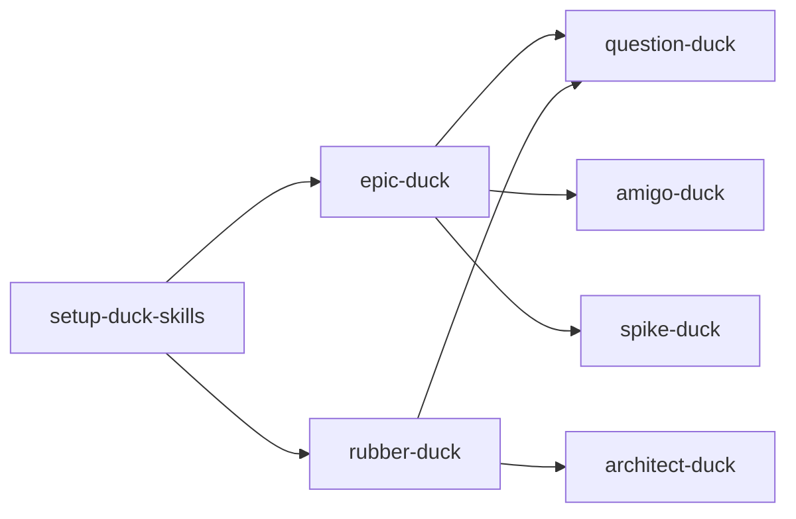

Spike: [0003-spike-skill-inventory.md](../items/0003-spike-skill-inventory.md)

# Skill inventory v2.2 — Status, Label, and Type alignment

**Version:** v2.2 (parallel re-read of spike 0003; this slice is **thorough on `Status:` vs `Label:` vs `Type: epic-duck:*`**). v1 remains at [0003-skill-inventory.md](./0003-skill-inventory.md) (unchanged).

## TLDR

Eight planning skills exist under `.cursor/skills/`; **`triage-duck` is still absent** (planned in [0001](../items/0001-plan-duck-skills-planning-refinement.md), design gated on [0006](../items/0006-decision-triage-duck-activation.md)). **`amigo-pato` is not in the repo** and is **out of plan** — only **`amigo-duck`** is in scope.

**Canon after decision [0005](../items/0005-decision-ticket-shapes-and-fields.md) and ADR [0001](../../docs/adr/0001-backlog-ticket-shapes.md):** local backlog items use **`Type: epic-duck:<kind>`** (first line) plus a single workflow field **`Status:`**. There is **no `Label:` header** on local markdown; deliverable work is **`Type: epic-duck:task`** with **`Status: ready`** and the deliverable body (not `Label: ready`). On **remote** trackers, **`epic-duck:*` strings are issue labels/tags** (type), while **`Status:` strings may be labels/tags and/or a `Status:` line in the body** — setup templates say “match team practice.”

**Skills aligned with canon:** `epic-duck`, `amigo-duck`, `setup-duck-skills` seeds, `docs/agents/backlog.md`, and live `.backlog/items/*` headers. **Residual drift:** resolved decision **[0002](../items/0002-decision-ready-ticket-quality-bar.md)** and spike **[0011](./0011-common-fields-and-skill-needs.md)** still describe **`Label: ready`** and bare **`Type: decision`**; remote **GitHub** template **Frontier** omits **`needs-triage`**. **`epic-duck`** prose still says plans are “labelled” without pointing local readers at **`Type:`**.

Invocation graph unchanged from v1: **epic-duck** → question-duck, amigo-duck, spike-duck; **rubber-duck** → question-duck, architect-duck; **setup-duck-skills** seeds docs others read.

---

## In-scope skills (presence and invocations)

| Skill | In repo | Invokes (explicit in `SKILL.md`) | Invoked by |
|-------|---------|-----------------------------------|------------|
| setup-duck-skills | Yes | None | User (`/setup-duck-skills`) |
| epic-duck | Yes | question-duck, amigo-duck, spike-duck | User; backlog.md “publish” path |
| rubber-duck | Yes | question-duck, architect-duck (by behaviour) | User |
| question-duck | Yes | Subagents for facts only | epic-duck, rubber-duck |
| architect-duck | Yes | None | rubber-duck |
| amigo-duck | Yes | None | epic-duck; backlog.md before publish |
| spike-duck | Yes | Background agent (skill text) | epic-duck |
| triage-duck | **No** | — (not implemented) | Future per 0006 |
| amigo-pato | **No** | — | **Out of plan** (not listed on 0001) |

Sources: `.cursor/skills/*/SKILL.md`, [0001](../items/0001-plan-duck-skills-planning-refinement.md) § Notes.

---

## `Status:` vs `Label:` vs `Type: epic-duck:*` (v2.2 focus)

### Three concepts agents must not conflate

| Concept | Local markdown | Remote (GitHub / GitLab / Azure DevOps) | Who defines it |
|---------|----------------|----------------------------------------|----------------|
| **Kind / role** | First-line **`Type: epic-duck:<kind>`** (`plan` \| `decision` \| `task` \| `spike`) | Label/tag **`epic-duck:plan`**, **`epic-duck:decision`**, etc. | ADR 0001, `docs/agents/backlog.md`, epic-duck templates |
| **Workflow state** | **`Status:`** on every item file | Same strings as **labels/tags** and/or **`Status:`** in issue body | `docs/agents/ticket-statuses.md` |
| **`Label:` (header)** | **Not used** in current canon | N/A as a markdown header | Superseded: spike 0011 proposed `Label: ready`; **0005 rejected** that in favour of **`Status: ready`** |

**Spike findings** (`.backlog/spike/*.md`): **no `Type:` or `Status:`**; lead with `Spike:` backlink and **`## TLDR`** (ADR 0001, `backlog.md`).

### `Status:` — single workflow field

Canonical values (all skills and docs that matter agree): `needs-triage`, `needs-detail`, `ready`, `in-progress`, `resolved`, `wontfix`, `out-of-scope`.

| Skill / doc | How it uses `Status:` |
|-------------|------------------------|
| **epic-duck** | Sets `in-progress` when a session claims a child; offers **`ready`** pool for work; resolves to `resolved` / terminal states; syncs plan tables. |
| **amigo-duck** | Gates **`Status: ready`** on deliverable **`epic-duck:task`** (full INVEST after Approve). Light INVEST for decisions/spikes at publish time. |
| **spike-duck** | Sets spike item **`Status: resolved`** when findings file is complete. |
| **setup-duck-skills** | Seeds `ticket-statuses.md`; on GitHub/GitLab may **create labels** matching status strings. |
| **triage-duck (future)** | 0006 / 0005: assume **only `Status:`** — no parallel `Label:` workflow (0011’s `Label: ready` is obsolete). |

**`needs-triage` vs `needs-detail`:** both are “not ready to execute.” **Frontier** (epic-duck, `backlog.md`) = unblocked children with **`needs-triage` or `needs-detail`**, lowest `NNNN` first. **Session pool** = unblocked **`ready`**. **Triage-duck** is expected to own transitions involving **`needs-triage`** once built (0006).

### `Type: epic-duck:*` — kind, not workflow

| `Type:` value | Filename pattern (local) | Body profile (summary) |
|---------------|--------------------------|-------------------------|
| `epic-duck:plan` | `*-plan-*.md` | Destination, tables; no `Plan:` / `Overview:` on plan file |
| `epic-duck:decision` | `*-decision-*.md` | `## Question` → `## Answer` when resolved |
| `epic-duck:task` | `<NNNN>-<slug>.md` (slug not `plan-` / `decision-` / `spike-`) | Unblocker: `## Question`; deliverable: **`Status: ready`** + Problem Statement, Description, AC |
| `epic-duck:spike` | `*-spike-*.md` | `## Question`, `Result:` → findings path |

**amigo-duck** branches INVEST rules by **`Type: epic-duck:*`** and **`Status: ready`** on tasks — matches ADR 0001.

**epic-duck** “Ticket types” section maps HITL/AFK to **`epic-duck:decision`**, **`epic-duck:task`**, **`epic-duck:spike`** — aligned.

**Wording gap:** epic-duck says the plan is “labelled `epic-duck:plan`.” On **local** markdown that means **`Type: epic-duck:plan`**, not a GitHub label. Agents on local backlog should not search for a `Label:` field.

### Remote mapping (labels/tags vs body)

| Field | Remote representation | setup-duck-skills |
|-------|----------------------|-------------------|
| Kind | Label/tag `epic-duck:<kind>` | Creates type labels on GitHub/GitLab setup (SKILL.md §4) |
| Workflow | Status strings as labels/tags **and/or** `Status:` in body | Same strings seeded in `ticket-statuses.md`; templates say “match team practice” |

Example from Azure seed: tags like `ready;epic-duck:plan` — **workflow and type coexist as separate tags** (`setup-duck-skills/backlog-azure-devops.md`).

**Caution:** Using **both** status labels and body `Status:` without a team rule can desync; skills do not pick one remote mode — **setup + team convention** must.

### `Label: ready` — historical only

| Source | Says | Current truth |
|--------|------|----------------|
| Spike **0011** | `Label: ready` on `Type: task` | **Superseded** by 0005 / ADR 0001 |
| Decision **0002** § Answer | `Label: ready` deliverables, `Type: decision` | **Stale** — 0002 is `resolved` but answer predates namespace unification; amigo gate is **`Status: ready`** |
| **amigo-duck**, **epic-duck**, **backlog.md**, live items | `Status: ready`, `Type: epic-duck:*` | **Aligned** |

No in-scope skill `SKILL.md` still instructs agents to write `Label:` on local files.

### Alignment checklist (in-scope skills)

| Skill | `Type: epic-duck:*` | `Status:` | `Label:` header |
|-------|---------------------|-----------|-----------------|
| setup-duck-skills | Templates in `backlog-local.md` match `docs/agents/backlog.md` | Seeds `ticket-statuses.md` | Not mentioned (correct) |
| epic-duck | Templates in skill body | Full session semantics | Uses “labelled” for remote/local kind — clarify local = `Type:` |
| amigo-duck | Explicit per kind | `Status: ready` on deliverable tasks | No |
| spike-duck | Spike item template via backlog.md | `resolved` on item when done | No |
| rubber-duck / question-duck / architect-duck | No backlog writes | — | — |
| triage-duck | N/A | Future: 0006 assumes unified `Status:` only | Must not reintroduce `Label:` |

---

## Per-skill: reads, writes, invocations

### setup-duck-skills

| | |
|--|--|
| **Reads** | `git remote`, `AGENTS.md` / `CLAUDE.md`, `GLOSSARY.md`, `GLOSSARY-MAP.md`, `docs/adr/`, `docs/agents/`, `.backlog/` |
| **Writes** | `docs/agents/backlog.md`, `docs/agents/domain.md`, optional `docs/agents/ticket-statuses.md`, agent skills block in `AGENTS.md` / `CLAUDE.md`, `.backlog/features.md` (local mode); may create remote **labels/tags** for **status strings** and **`epic-duck:*`** |
| **Backlog** | Seeds tracker doc; empty feature index for local mode |
| **Domain** | Seeds `domain.md` only |
| **Invokes** | None |

Source: `.cursor/skills/setup-duck-skills/SKILL.md`.

### epic-duck

| | |
|--|--|
| **Reads** | `docs/agents/backlog.md`, `.backlog/features.md`, plan and child items, `git status` (feature-file guard), `docs/agents/ticket-statuses.md` (by reference) |
| **Writes** | `.backlog/items/*`, `.backlog/features.md`, plan **Decisions** / **Tasks** / **Spikes** tables, **Decisions so far**; delegates spike **findings** to spike-duck |
| **Backlog** | Primary writer; sets **`Type:`** and **`Status:`** on items |
| **Domain** | No glossary/ADR writes |
| **Invokes** | question-duck (charting, decisions), amigo-duck (pre-publish, all types per skill), spike-duck (spike items) |

Source: `.cursor/skills/epic-duck/SKILL.md`.

### rubber-duck

| | |
|--|--|
| **Reads** | `docs/agents/domain.md` |
| **Writes** | `GLOSSARY.md`, `docs/adr/*` (via architect-duck behaviour) |
| **Backlog** | None |
| **Invokes** | question-duck, architect-duck |

Source: `.cursor/skills/rubber-duck/SKILL.md`.

### question-duck

| | |
|--|--|
| **Reads** | Repo via subagents |
| **Writes** | None mandated |
| **Invokes** | Subagents for facts |

Source: `.cursor/skills/question-duck/SKILL.md`.

### architect-duck

| | |
|--|--|
| **Reads** | `docs/agents/domain.md`, `GLOSSARY.md`, `GLOSSARY-MAP.md`, `docs/adr/`, code |
| **Writes** | `GLOSSARY.md`, `docs/adr/*.md` (lazy create); uses `GLOSSARY-FORMAT.md`, `ADR-FORMAT.md` |
| **Backlog** | None |

Source: `.cursor/skills/architect-duck/SKILL.md`.

### amigo-duck

| | |
|--|--|
| **Reads** | User intent, draft ticket (including **`Type:`** / **`Status:`**) |
| **Writes** | Review markdown (`## amigo-duck review`); revised body — publish is separate |
| **Backlog** | Quality gate before publish; vocabulary matches ADR 0001 |
| **Invokes** | None |

Source: `.cursor/skills/amigo-duck/SKILL.md`.

### spike-duck

| | |
|--|--|
| **Reads** | Primary sources; `docs/agents/backlog.md` for paths |
| **Writes** | `.backlog/items/<NNNN>-spike-<slug>.md` when creating item; `.backlog/spike/<NNNN>-<slug>.md` findings |
| **Backlog** | May allocate `NNNN` when creating spike item; should prefer existing item when epic-duck already linked **`Result:`** |
| **Invokes** | Background agent (skill text) |

Source: `.cursor/skills/spike-duck/SKILL.md`.

### triage-duck (planned)

| | |
|--|--|
| **Reads** | Expected: `.backlog/items/*`, `docs/agents/ticket-statuses.md`, plan tables (per 0006) |
| **Writes** | Expected: **`Status:`** transitions only (no `Label:` per 0005) |
| **Invokes** | TBD in 0006 (user-only vs callable from epic-duck / setup) |

Sources: [0006](../items/0006-decision-triage-duck-activation.md), [0010](../items/0010-implement-triage-duck.md), ADR 0001 consequences.

### amigo-pato

Not present under `.cursor/skills/` in this workspace. **Out of plan** per 0001 in-scope list. If it appears elsewhere, treat as duplicate/experiment of **amigo-duck**, not a planning-refinement skill.

---

## Dependency graph (invocation)

---

## Contradictions and drift (v2.2)

| ID | Topic | A | B | Severity | Notes |
|----|--------|---|---|----------|-------|
| D1 | `Label: ready` vs `Status: ready` | 0002 Answer, spike 0011 | 0005, ADR 0001, amigo-duck, backlog.md, live `.backlog/items/*` | **Medium** | Resolved in canon; **stale text in resolved 0002** misleads agents reading decisions |
| D2 | `Type: decision` vs `Type: epic-duck:decision` | 0002 Answer | ADR 0001, all current item headers | **Medium** | Same as D1 — amend 0002 Answer or add pointer to 0005 |
| D3 | “Labelled” plan | epic-duck prose | Local uses **`Type:`** line | **Low** | Clarify one sentence in epic-duck |
| D4 | Remote frontier | `backlog-github.md`: frontier “`needs-detail` (or open)” | `backlog.md` / epic-duck: **`needs-triage` or `needs-detail`** | **Low** | GitHub repos using `needs-triage` labels need template fix |
| D5 | Spike item `Result:` vs multi-version findings | Item 0003 `Result:` → v1 only | Item body lists v2.1–v2.4 paths | **Low** | Operational: link all versions in `## Comments` or extend `Result:` |
| D6 | spike-duck numbering | spike-duck: allocate next `NNNN` when creating item | epic-duck charting creates spike item first | **Low** | spike-duck should say “use existing spike item when `Result:` already set” (v1 C5) |
| D7 | amigo-duck on decisions | epic-duck: amigo-duck on **all** ticket types | 0002: decisions also need **Decision resolution** eval metric | **Low** | Complementary, not contradictory |
| D8 | Rubber vs epic backlog | rubber-duck: no backlog | epic-duck: backlog writer | **None** | Handoff for 0004 |
| D9 | README vs AGENTS | README lists user vs model-invoked skills | AGENTS.md: backlog/status/domain only | **None** | README is catalog; AGENTS is runtime pointers |

**Resolved since v1 (do not reopen):** separate spike-as-decision `Type:` (C1–C2 in v1); local `Type: epic-duck:*` on markdown items now matches epic-duck templates and `backlog.md`.

**AGENTS.md / README:** Both point at `docs/agents/backlog.md` and **`Status:`** on items — consistent with canon. Neither mentions `Label:`.

---

## Gaps for follow-on work

- **0006 / 0010** — triage-duck reads/writes **`Status:`** only; define who sets **`ready`** vs amigo-duck.
- **0002 hygiene** — align Answer text with 0005 (`Status: ready`, `Type: epic-duck:*`).
- **0008** — evals assert setup outputs before epic-duck / rubber-duck.
- **0004** — choreography; amigo-duck on rubber-duck outputs not specified in rubber-duck.
- **epic-duck / spike-duck / backlog-github** — small wording fixes (D3, D4, D6).

---

## Evidence index

| Claim | Source |
|-------|--------|
| In-scope skill list | `.backlog/items/0001-plan-duck-skills-planning-refinement.md` |
| `Type:` + `Status:` canon | `docs/adr/0001-backlog-ticket-shapes.md`, `docs/agents/backlog.md` |
| No `Label:` header | `.backlog/items/0005-decision-ticket-shapes-and-fields.md` § Answer |
| Stale `Label: ready` | `.backlog/items/0002-decision-ready-ticket-quality-bar.md` § Answer; `.backlog/spike/0011-common-fields-and-skill-needs.md` |
| amigo-duck kinds | `.cursor/skills/amigo-duck/SKILL.md` |
| Remote type + status labels | `.cursor/skills/setup-duck-skills/SKILL.md`, `backlog-github.md`, `backlog-azure-devops.md` |
| triage-duck future | `.backlog/items/0006-decision-triage-duck-activation.md` |
| Per-skill I/O | `.cursor/skills/*/SKILL.md` |
