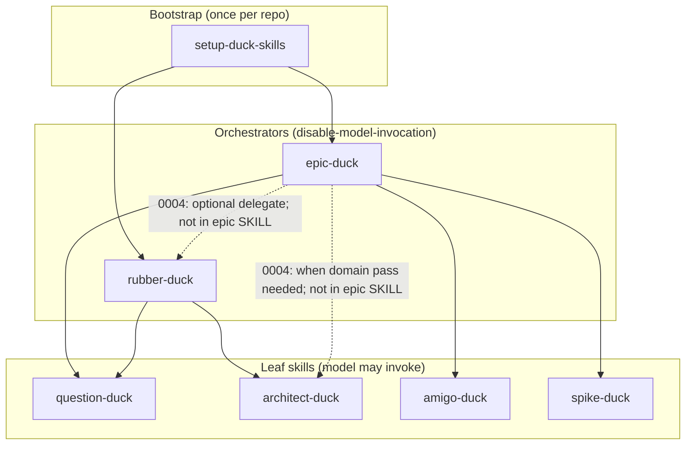
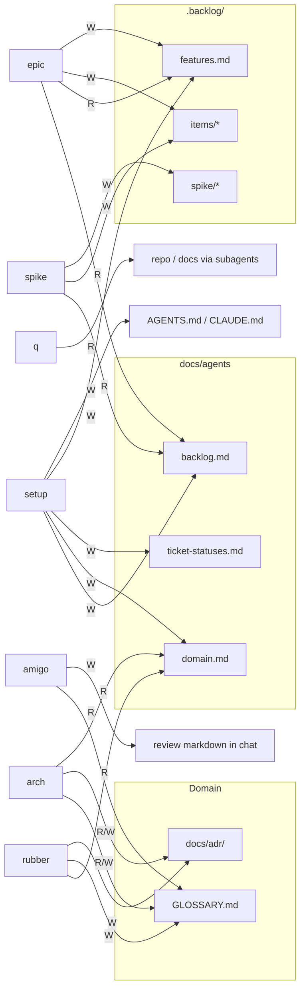

Spike: [0003-spike-skill-inventory.md](../items/0003-spike-skill-inventory.md)

# Skill inventory v2.3 — composition graph and contradiction severity

**Scope:** In-repo skills under `.cursor/skills/` (eight skills; **`triage-duck` not present**). Sources: skill `SKILL.md` files, `docs/agents/*`, `docs/adr/0001-backlog-ticket-shapes.md`, `AGENTS.md`, `README.md`, resolved decision [0004](../items/0004-decision-planning-pipeline-choreography.md). Per-skill read/write tables remain in [v1](./0003-skill-inventory.md); this pass adds **composition** (who invokes whom, what artefacts flow) and a **severity-ranked contradiction register** after ADR 0001.

## TLDR

Planning skills form a **three-layer composition**: **setup-duck-skills** seeds `docs/agents/*` (and optional `.backlog/`); **orchestrators** (**epic-duck**, **rubber-duck**) compose **leaf** skills (**question-duck**, **architect-duck**, **amigo-duck**, **spike-duck**). Epic-duck owns the backlog write path for plans and children; rubber-duck’s skill text still describes **domain docs only**, which **contradicts** decision 0004’s rubber backlog rules (**high**). Epic-duck’s skill text **never names architect-duck** (or rubber delegation) while 0004’s golden path requires architect-duck during epic work (**high**). ADR 0001, `docs/agents/backlog.md`, and skill templates largely **align** on `Type: epic-duck:*` and unified `Status:`; remaining drift is mostly **stale decision prose** (`Type: decision`, `Label: ready` in 0002) and **overloaded terms** (`frontier` in question-duck vs epic-duck). **Critical:** none — agents can still read ADR/backlog as SSOT.

---

## Severity scale

| Level | Meaning | Action |
|-------|---------|--------|
| **Critical** | Opposite instructions on the same write path; likely corrupt backlog or domain SSOT | Fix before relying on automation |
| **High** | Resolved decision or README choreography ≠ skill `SKILL.md` | Skill edit or explicit “see 0004” in orchestrators |
| **Medium** | Terminology or historical doc; SSOT (`backlog.md`, ADR 0001) is clear | Cross-link or refresh child decisions |
| **Low** | Process nuance, eval artefacts, or edge workflow | Document in skill when convenient |
| **None** | Intentional split of concerns | No change |

---

## Composition graph (skill invocation)

### Orchestration (user-facing entry points)

**Legend:** Solid arrows = stated in orchestrator `SKILL.md`. Dashed = stated only in [0004](../items/0004-decision-planning-pipeline-choreography.md) / plan **Notes**, not in epic-duck text.

### Delegation (non-skill subagents)

| Caller | Delegate | Role |
|--------|----------|------|
| **question-duck** | Subagents | Filesystem, docs, tooling lookups (facts only) |
| **spike-duck** | Background agent | Primary-source investigation; writes findings file |
| **epic-duck** (charting) | Parallel subagents | Optional spike branches (`spike/<name>`); findings via spike-duck |

Sources: `.cursor/skills/question-duck/SKILL.md`, `.cursor/skills/spike-duck/SKILL.md`, `.cursor/skills/epic-duck/SKILL.md` (charting step 5).

### Composition matrix (declared invokes)

| Skill | Invokes (per skill text) | Invoked by |
|-------|--------------------------|------------|
| setup-duck-skills | — | User; eval harness (0004) |
| epic-duck | question-duck, amigo-duck, spike-duck | User |
| rubber-duck | question-duck, architect-duck | User |
| question-duck | Subagents only | epic-duck, rubber-duck; model may attach directly |
| architect-duck | — | rubber-duck; 0004 also epic-duck (undocumented in epic SKILL) |
| amigo-duck | — | epic-duck (all ticket types before publish); 0004 also rubber-duck |
| spike-duck | Background agent | epic-duck (spike children); user/model per description |
| triage-duck | — | **Not in repo** (0006 / 0010) |

### README vs plan entry points

| Doc | question-duck / architect-duck |
|-----|----------------------------------|
| **README.md** | Listed under **Model-invoked** skills (catalog only) |
| **0001 plan Notes** | Not standalone user entry in v1; only inside epic or rubber |
| **0004 Answer** | Same as plan; skill text follow-up listed |

Model-invocation is **allowed** by Cursor for question-duck and architect-duck (no `disable-model-invocation`). Choreography intent is **social** (prefer epic/rubber), not enforced in YAML — **low** product gap, not a file-shape contradiction.

---

## Composition graph (artefacts)

Artefacts are **nodes**; edges are **read** (R) or **write** (W). Primary writers in bold.

**0004 expectation not on diagram solid edges:** rubber-duck **W** → `items/*` and rubber → amigo-duck before publish (decision 0004; **missing** from rubber-duck `SKILL.md`).

**Consumer chain:** `setup-duck-skills` → all skills that read `docs/agents/backlog.md` or `domain.md`. **amigo-duck** does not read backlog.md by requirement but gates publishes defined there.

Sources: skill files above; `docs/agents/backlog.md`; `docs/agents/domain.md`; ADR 0001.

---

## Contradiction register (severity-ranked)

Sorted by severity (Critical → Low). IDs are **v2.3** (v1 C1–C2 marked resolved in ADR era).

| ID | Severity | Topic | Source A | Source B | Notes |
|----|----------|-------|----------|----------|-------|
| **H1** | **High** | Rubber backlog scope | [0004](../items/0004-decision-planning-pipeline-choreography.md) § Rubber-duck backlog rules: may create decisions, tasks, spike items on **confirmed** feature; amigo-duck before publish | `.cursor/skills/rubber-duck/SKILL.md`: question-duck + architect-duck; **GLOSSARY / ADR only**; no backlog | Skill text omits entire rubber golden path from 0004 |
| **H2** | **High** | Epic + architect-duck | 0004 § Shared behaviours: epic **invokes architect-duck** when domain/docs need updating; may delegate to rubber-duck | `.cursor/skills/epic-duck/SKILL.md`: invokes question-duck, amigo-duck, spike-duck only | Epic sessions that need glossary/ADR lack an in-skill hook |
| **H3** | **High** | Rubber + amigo-duck | 0004: amigo-duck before publish for items created by epic **or rubber** | `rubber-duck/SKILL.md`: no amigo-duck | Same gap as H1 |
| **M1** | **Medium** | `frontier` term | `question-duck/SKILL.md`: frontier = unsettled Q&A tree | `epic-duck/SKILL.md` + `backlog.md`: frontier = unblocked `needs-triage` / `needs-detail` children | Homonym; agents in one session may confuse layers |
| **M2** | **Medium** | Type / status vocabulary in old decisions | [0002](../items/0002-decision-ready-ticket-quality-bar.md): `Type: decision`, `Label: ready` | ADR 0001 + `docs/agents/backlog.md`: `Type: epic-duck:*`, `Status: ready` | SSOT is current; 0002 is historical prose |
| **M3** | **Medium** | Spike item numbering | `spike-duck/SKILL.md` step 1: allocate next `NNNN` when creating spike **item** | `epic-duck/SKILL.md` charting: creates spike item + `Result:` first; spike-duck fills findings | Risk of duplicate item if spike-duck allocates blindly |
| **M4** | **Medium** | Plan “skill text follow-up” | 0004 § Skill text follow-up: update epic, rubber, question-duck, architect-duck | Partial: templates/ADR/amigo heading updated; **H1–H2** gaps remain | Tracking debt, not ambiguous SSOT |
| **L1** | **Low** | Plan label wording | `epic-duck/SKILL.md`: plan “labelled `epic-duck:plan`” | Local: `Type: epic-duck:plan` + filename; no GitHub label | Same as v1 C6; backlog.md explains local |
| **L2** | **Low** | Standalone leaf invocation | 0001 / 0004: prefer epic/rubber wrappers | `question-duck` / `architect-duck` descriptions invite direct invoke; README lists as model-invoked | Intentional flexibility vs choreography doc |
| **L3** | **Low** | Spike-duck typo | `spike-duck/SKILL.md`: “authritative” | — | Cosmetic |
| **—** | **Resolved** | Spike as decision type | v1 C1–C2 | ADR 0001 + `Type: epic-duck:spike` item files | — |
| **—** | **Resolved** | amigo review heading | v1 C4 | `amigo-duck/SKILL.md` + ADR 0001: `## amigo-duck review` | — |
| **—** | **None** | Epic backlog vs rubber domain | epic: backlog; rubber skill: domain-only **today** | 0004 intends rubber backlog | Intentional **once skills match 0004**; currently **H1** |

### Cross-doc alignment (no contradiction)

| Check | Result |
|-------|--------|
| `docs/agents/backlog.md` vs `setup-duck-skills/backlog-local.md` | Match (local seed = deployed doc) |
| `docs/agents/ticket-statuses.md` vs setup seed | Match |
| `docs/agents/domain.md` vs setup seed | Match |
| `AGENTS.md` pointers | Match backlog / ticket-statuses / domain paths |
| `README.md` skill list vs `.cursor/skills/` | Eight skills; triage-duck only on roadmap |
| ADR 0001 vs amigo-duck / epic-duck templates | `Type: epic-duck:*`, deliverable task body, spike TLDR |

---

## Suggested follow-ups (from graph + register)

| Target | Addresses |
|--------|-----------|
| **rubber-duck/SKILL.md** | H1, H3: confirmed feature, child item writes, amigo-duck gate |
| **epic-duck/SKILL.md** | H2: architect-duck (and optional rubber-duck) in Work through / decision resolution |
| **spike-duck/SKILL.md** | M3: “use existing spike item when `Result:` / item file exists” |
| **0013** (out of scope) | Skill-usage scenarios for both golden paths in 0004 |
| **GLOSSARY** (optional) | M1: disambiguate “frontier” (interview vs backlog) |

---

## Evidence index

| Claim | Path |
|-------|------|
| Epic invokes list | `.cursor/skills/epic-duck/SKILL.md` § Creating the plan, Ticket types, Chart/Work through |
| Rubber composition | `.cursor/skills/rubber-duck/SKILL.md` |
| Choreography golden paths | `.backlog/items/0004-decision-planning-pipeline-choreography.md` § Answer |
| Backlog SSOT | `docs/agents/backlog.md`, `docs/adr/0001-backlog-ticket-shapes.md` |
| In-scope skill set | `.backlog/items/0001-plan-duck-skills-planning-refinement.md` § Notes |
| Agent skills index | `AGENTS.md`, `README.md` § Skills catalog |
