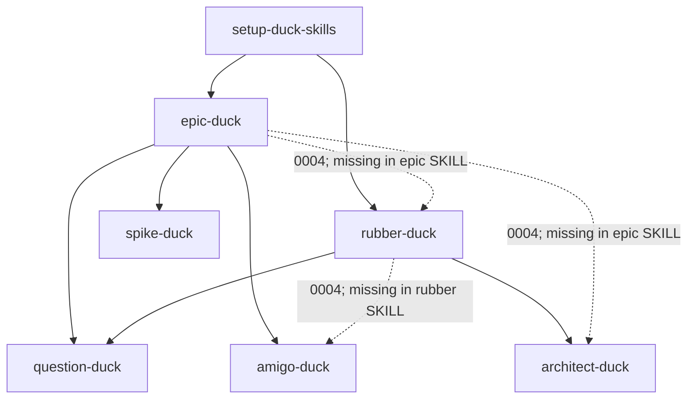

Spike: [0003-spike-skill-inventory.md](../items/0003-spike-skill-inventory.md)

# Skill inventory v2.4 — synthesis (parallel runs v2.1–v2.3)

**Version:** v2.4 — consolidates three concurrent re-reads ([v2.1](./0003-skill-inventory-v2.1.md), [v2.2](./0003-skill-inventory-v2.2.md), [v2.3](./0003-skill-inventory-v2.3.md)). Historical baseline: [v1](./0003-skill-inventory.md) (pre–ADR 0001; unchanged).

## TLDR

All three parallel passes agree: **seven in-scope skills ship in `.cursor/skills/`**; **`triage-duck` is still missing** (0006 / 0010). After **ADR 0001** and `docs/agents/backlog.md`, **local backlog shape is coherent**: first-line **`Type: epic-duck:*`**, single workflow **`Status:`**, spike findings are `Spike:` + **`## TLDR`** only. **No critical contradictions** on file shapes — agents can treat ADR + `backlog.md` as SSOT.

The **main open problem is choreography drift**: resolved **[0004](../items/0004-decision-planning-pipeline-choreography.md)** says **rubber-duck** may write backlog children (with **amigo-duck** before publish) and **epic-duck** may invoke **architect-duck** (or delegate **rubber-duck**), but **`epic-duck/SKILL.md` and `rubber-duck/SKILL.md` still describe the older split** (epic = backlog only; rubber = glossary/ADR only). **README** still oversimplifies rubber → “tickets.” Secondary drift: **0002** and **0011** retain **`Label: ready`** / bare **`Type: decision`** prose; **epic-duck** “labelled `epic-duck:plan`” wording confuses local **`Type:`** readers; **spike-duck** vs **epic-duck** spike-item numbering can duplicate `NNNN` if both allocate.

**Recommended follow-ups:** skill edits for **0004** golden paths (was **0013**, now out of scope — do via direct task or skill PR); **0006** for triage; optional **0002** Answer hygiene; README alignment.

---

## Consensus inventory (post–ADR 0001)

| Skill | In repo | Invokes (`SKILL.md`) | Primary reads | Primary writes |
|-------|---------|----------------------|---------------|----------------|
| setup-duck-skills | Yes | — | remotes, agent docs, `.backlog/` | `docs/agents/*`, `AGENTS.md`/`CLAUDE.md`, `.backlog/features.md`; remote status + `epic-duck:*` labels |
| epic-duck | Yes | question-duck, amigo-duck, spike-duck | `backlog.md`, `features.md`, items, `ticket-statuses` | `.backlog/items/*`, plan tables, blocker sweeps |
| rubber-duck | Yes | question-duck, architect-duck | `domain.md` | `GLOSSARY.md`, `docs/adr/*` (**skill text**); **0004** also backlog children |
| question-duck | Yes | subagents | repo (via subagents) | none mandated |
| architect-duck | Yes | — | domain, glossary, ADR, code | glossary, ADR |
| amigo-duck | Yes | — | draft ticket + intent | `## amigo-duck review` in chat |
| spike-duck | Yes | background agent | sources, `backlog.md` | spike findings; may create spike **item** |
| triage-duck | **No** | TBD (0006) | items, statuses (expected) | `Status:` transitions (expected) |

**Out of plan:** any non-listed skill dir (e.g. experiments); not part of planning-refinement v1.

---

## Invocation (skills + 0004 intent)

Solid = stated in orchestrator `SKILL.md`. Dashed = **0004** only.

---

## Consolidated contradiction register

| ID | Severity | Topic | Resolution target |
|----|----------|-------|-------------------|
| **C-0004-rubber** | High | Rubber backlog + amigo per **0004** vs rubber skill (domain-only) | `rubber-duck/SKILL.md` |
| **C-0004-epic-arch** | High | Epic → architect-duck / rubber per **0004** vs epic invoke list | `epic-duck/SKILL.md` |
| **C-readme-rubber** | Medium | README planning flow → rubber “tickets” vs rubber skill | `README.md` |
| **C-0002-stale** | Medium | `Label: ready`, `Type: decision` in **0002** Answer | Amend or pointer to **0005**/ADR |
| **C-0011-stale** | Medium | `Label: ready` in spike **0011** | Mark historical (already superseded note) |
| **C-epic-labelled** | Low | “labelled `epic-duck:plan`” vs local `Type:` | `epic-duck/SKILL.md` one line |
| **C-github-frontier** | Low | `backlog-github.md` frontier omits `needs-triage` | setup seed template |
| **C-spike-NNNN** | Low | spike-duck allocates `NNNN` when epic already created item | `spike-duck/SKILL.md` |
| **C-frontier-term** | Low | “frontier” in question-duck vs epic/backlog | glossary optional |
| **C-plan-notes** | Low | Plan Notes: epic uses architect-duck; epic SKILL omits | align plan or skill |

**Resolved since v1:** spike-as-decision `Type` (ADR 0001); amigo review heading; local `Type: epic-duck:*` on items.

---

## Relation to v1

| v1 finding | v2.4 status |
|------------|-------------|
| C1–C2 epic vs backlog spike/`Type` | **Resolved** (ADR 0001) |
| triage-duck missing | **Still true** |
| epic primary backlog writer | **Still true** |
| amigo before publish | **Still true**; rubber path missing in skill |

---

## Evidence

| Topic | Path |
|-------|------|
| Skills | `.cursor/skills/*/SKILL.md` |
| Tracker SSOT | `docs/agents/backlog.md`, `docs/adr/0001-backlog-ticket-shapes.md` |
| Choreography | `.backlog/items/0004-decision-planning-pipeline-choreography.md` |
| Parallel runs | [v2.1](./0003-skill-inventory-v2.1.md), [v2.2](./0003-skill-inventory-v2.2.md), [v2.3](./0003-skill-inventory-v2.3.md) |

---

## Major differences between sub-agent reviews (v2.1 vs v2.2 vs v2.3)

| Dimension | **v2.1** | **v2.2** | **v2.3** |
|-----------|----------|----------|----------|
| **Primary lens** | Full per-skill I/O tables + **0004 vs SKILL.md** drift (R1–R9) | Deep **`Status:` / `Label:` / `Type:`** canon and remote mapping | **Composition graphs** (invoke + artefacts) + **severity-ranked** register |
| **Skill count wording** | “Seven skills” in repo (+ triage planned) | “Eight planning skills” table **including triage row** as absent | “Eight skills; triage not present” |
| **amigo-pato** | Notes dir **present**, out of plan | Claims **not in repo** (workspace-dependent) | Not emphasized |
| **Rubber vs epic backlog** | **High** (R1): 0004 vs rubber SKILL | **D8 “None”** — intentional handoff epic backlog / rubber domain **without** citing 0004 rubber backlog rules | **High H1–H3**: rubber backlog + amigo + epic/architect gaps vs 0004 |
| **Stale 0002 / 0011 `Label: ready`** | Mentioned via R9 / historical 0011 | **Central** (D1–D2); detailed three-concept table | **Medium M2** in register |
| **README issues** | **R3** rubber → tickets; flow omits amigo/spike | **D9** AGENTS vs README as non-contradiction | Brief README vs 0004 entry points (**L2**) |
| **Unique artifacts** | Planned triage section; ADR cross-check matrix; follow-on table citing 0013 | Alignment checklist per skill; Azure tag example; question-duck typo callout | Mermaid artefact flow; **severity scale**; explicit “no Critical” |
| **spike-duck numbering** | R5 low | D6 low | M3 medium |
| **Follow-on emphasis** | 0013 skill-text sync, README, 0008 eval | 0006 triage, 0002 hygiene, 0008, 0004 rubber amigo | rubber + epic SKILL edits; 0013 out of scope note |

### Interpretation

- **v2.1** is the best **operational handbook** (per-skill tables, triage planned I/O, explicit README/0004 gaps).
- **v2.2** is the best **vocabulary guardrail** for agents editing backlog markdown (retired `Label:` vs `Status: ready`).
- **v2.3** is the best **risk triage** view: agrees with v2.1 on **0004 vs SKILL** severity but disagrees with v2.2’s “no rubber/epic contradiction” framing.

**Synthesis choice (v2.4):** treat **0004 vs orchestrator SKILL text** as **high** priority (v2.1 + v2.3), adopt v2.2’s **Status/Type** canon as settled, and keep v1 + v2.1 per-skill detail as reference appendices rather than duplicating full tables here.
