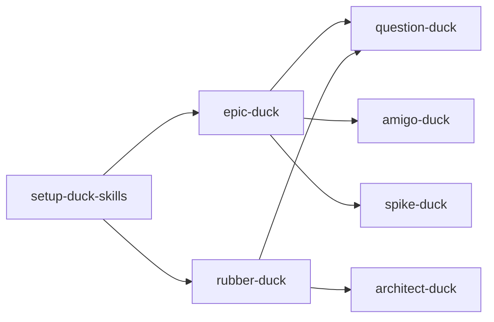

Spike: [0003-spike-skill-inventory.md](../items/0003-spike-skill-inventory.md)

# Skill inventory (planning duck-skills)

## TLDR

Eight skills are in scope for the planning-refinement feature; **`triage-duck` is not in the repo yet** (only referenced on the plan). **`setup-duck-skills`** seeds `docs/agents/*` and optional `.backlog/`; **`epic-duck`** is the only skill that routinely **writes** the local backlog. **`rubber-duck`** composes **question-duck** + **architect-duck** and updates **glossary/ADRs**, not backlog tickets. **`amigo-duck`** and **question-duck** are review/interview skills with no mandated file writes. **`spike-duck`** writes spike findings under `.backlog/spike/`.

Several **doc contradictions** matter for **0005** / **0011**: **epic-duck** still lists `Type: spike` on **issues** while **`docs/agents/backlog.md`** keeps spikes as separate item files; **amigo-duck** uses remote-style labels (`epic-duck:spike`) and a **“3 amigos session”** heading that does not match local ticket shape. Remote tracker templates under `setup-duck-skills/backlog-*.md` use **`epic-duck:<type>`** tags; local markdown uses filenames and **Issues** / **Spikes** tables instead—skills should not imply local items carry GitHub-style labels unless `Label:` is set.

Sources: `.cursor/skills/*/SKILL.md`, `docs/agents/backlog.md`, `docs/agents/domain.md`, `docs/agents/ticket-labels.md`, plan [0001](../items/0001-plan-duck-skills-planning-refinement.md).

---

## In-scope skills

| Skill | Present in repo | Invokes (per skill text) |
|-------|-----------------|---------------------------|
| setup-duck-skills | Yes | None |
| epic-duck | Yes | question-duck, amigo-duck, spike-duck |
| rubber-duck | Yes | question-duck, architect-duck |
| question-duck | Yes | Subagents for facts only |
| architect-duck | Yes | None |
| amigo-duck | Yes | None |
| spike-duck | Yes | Background agent |
| triage-duck | **No** | — |

---

## Per-skill: reads, writes, artefacts

### setup-duck-skills

| | |
|--|--|
| **Reads** | `git remote`, `AGENTS.md` / `CLAUDE.md`, `GLOSSARY.md`, `GLOSSARY-MAP.md`, `docs/adr/`, `docs/agents/`, `.backlog/` |
| **Writes** | `docs/agents/backlog.md`, `docs/agents/domain.md`, optional `docs/agents/ticket-labels.md`, `AGENTS.md` or `CLAUDE.md` (Agent skills block), `.backlog/features.md` when local backlog chosen; may create GitHub/GitLab labels |
| **Backlog** | Seeds tracker doc; creates empty feature index for local mode |
| **Domain** | Seeds `domain.md`; does not write glossary/ADR content |
| **Labels** | Optional copy of `ticket-labels.md` defaults |

Source: `.cursor/skills/setup-duck-skills/SKILL.md`.

### epic-duck

| | |
|--|--|
| **Reads** | `docs/agents/backlog.md`, `.backlog/features.md`, plan and child item files, `git status` (feature-file check) |
| **Writes** | `.backlog/items/*` (plans, issues, spike items), `.backlog/features.md`, plan **Issues** / **Spikes** tables; spike **findings** via spike-duck |
| **Backlog** | Primary writer for plans, issues, spikes, blocking, status |
| **Domain** | Does not update glossary/ADR |
| **Labels** | Mentions `epic-duck:plan` (remote-oriented); local items use `Status:` and optional `Label: ready` per `ticket-labels.md` |

Source: `.cursor/skills/epic-duck/SKILL.md`.

### rubber-duck

| | |
|--|--|
| **Reads** | `docs/agents/domain.md`, glossary/ADR layout |
| **Writes** | `GLOSSARY.md`, `docs/adr/*` (via architect-duck behaviour) |
| **Backlog** | None |
| **Domain** | Primary session skill for glossary + ADR updates |

Source: `.cursor/skills/rubber-duck/SKILL.md`, `.cursor/skills/architect-duck/SKILL.md`.

### question-duck

| | |
|--|--|
| **Reads** | Repo/docs via subagents; no fixed paths |
| **Writes** | None in skill text (conversation only until another skill publishes) |
| **Backlog** | None directly |

Source: `.cursor/skills/question-duck/SKILL.md`.

### architect-duck

| | |
|--|--|
| **Reads** | `docs/agents/domain.md`, `GLOSSARY.md`, `GLOSSARY-MAP.md`, `docs/adr/`, code for cross-check |
| **Writes** | `GLOSSARY.md`, `docs/adr/*.md` (lazy create); uses `GLOSSARY-FORMAT.md`, `ADR-FORMAT.md` |
| **Backlog** | None |

Source: `.cursor/skills/architect-duck/SKILL.md`.

### amigo-duck

| | |
|--|--|
| **Reads** | User intent + draft ticket body; points to `GLOSSARY.md` for terms |
| **Writes** | Review markdown (verdict); may output revised ticket body—publish is separate |
| **Backlog** | Reviews before publish; does not define local file shape beyond generic “acceptance criteria” |

Source: `.cursor/skills/amigo-duck/SKILL.md`.

### spike-duck

| | |
|--|--|
| **Reads** | Primary sources per question; `docs/agents/backlog.md` for paths |
| **Writes** | `.backlog/items/<NNNN>-spike-<slug>.md` (when creating item), `.backlog/spike/<NNNN>-<slug>.md` findings |
| **Backlog** | Spike item + findings; sets item `resolved` when complete |

Source: `.cursor/skills/spike-duck/SKILL.md`.

### triage-duck (planned)

Not present under `.cursor/skills/`. Plan and `ticket-labels.md` assume future triage over `needs-triage`, `needs-detail`, `ready`, `wontfix`. **setup-duck-skills** skips label setup unless user plans triage.

Sources: `0001` plan Notes, `docs/agents/ticket-labels.md`.

---

## Dependency graph (invocation)

**Consumers of setup outputs:** epic-duck, rubber-duck (and any skill that reads `docs/agents/backlog.md` or domain docs). **amigo-duck** is downstream of drafting, not of setup directly.

---

## Contradictions and drift

| # | Topic | Skill / doc A | Skill / doc B | Severity |
|---|--------|---------------|---------------|----------|
| C1 | Issue `Type: spike` | epic-duck issue template: `Type:` is `planning`, `spike` or `task` | `docs/agents/backlog.md`: `Type:` is `planning` or `task`; spikes are separate files | **High** — agents may add invalid `Type: spike` on issues |
| C2 | Spike as issue vs item | epic-duck **Ticket types**: “**spike** (AFK): use spike item” | Same file issue template includes `spike` as `Type` | **High** — duplicate/confusing spike model |
| C3 | Remote labels on local tickets | amigo-duck: decision tickets `` `epic-duck:spike`, `planning` `` | Local backlog has no `epic-duck:*` tags; spikes have no `Type:` line | **Medium** — clarify local vs remote in amigo-duck |
| C4 | Review heading | amigo-duck output: `## 3 amigos session` | Skill name is **amigo-duck**; separate `3-amigos` skill may exist elsewhere | **Low** — naming/consistency for eval artefacts |
| C5 | Spike numbering | spike-duck: “Allocate the next shared `NNNN`” when creating spike item | epic-duck charting creates spike item first, then spike-duck fills result | **Low** — spike-duck should say “use existing spike item when `Result:` already linked” |
| C6 | Plan label | epic-duck: plan labelled `epic-duck:plan` | Local tracker uses `features.md` + `*-plan-*.md` filename, not a label field | **Medium** — document local equivalent |
| C7 | Rubber vs epic backlog | rubber-duck: no backlog writes | epic-duck: backlog-only planning | **None** — intentional; **0004** should document handoff |
| C8 | Glossary in planning tickets | amigo-duck: define terms or point to `GLOSSARY.md` | epic-duck planning issues use `## Question` not AC | **Low** — amigo-duck already allows light INVEST for decisions |

**Not contradictions:** `setup-duck-skills/backlog-local.md` matches `docs/agents/backlog.md` in this repo (seed sync). Remote templates (`backlog-github.md`, etc.) intentionally describe labels/sub-issues instead of `.backlog/` paths.

---

## Gaps for follow-on tickets

- **0004** — choreography: when rubber-duck vs epic-duck; whether amigo-duck runs on rubber-duck outputs (not specified in rubber-duck).
- **0005** / **0011** — align epic-duck SKILL with `backlog.md` (C1, C2); harmonise amigo-duck local vs remote vocabulary (C3).
- **0010** — triage-duck artefact reads/writes once implemented.
- **0008** — assert setup-duck-skills outputs before other skills run.

---

## Evidence index

| Claim | Source path |
|-------|-------------|
| Epic-duck invokes | `.cursor/skills/epic-duck/SKILL.md` (Creating the plan, Ticket types, Work through) |
| Rubber-duck invokes | `.cursor/skills/rubber-duck/SKILL.md` |
| Local issue `Type:` | `docs/agents/backlog.md` § Issue file body |
| Epic issue `Type:` includes spike | `.cursor/skills/epic-duck/SKILL.md` § Issue body |
| In-scope list | `.backlog/items/0001-plan-duck-skills-planning-refinement.md` § Notes |
