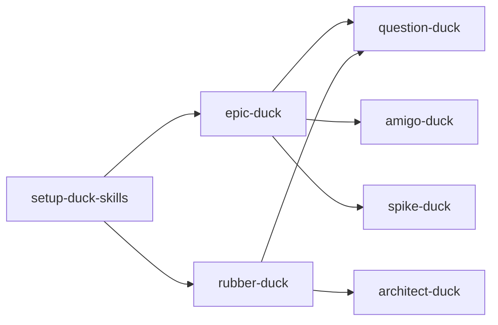

Spike: [0003-spike-skill-inventory.md](../items/0003-spike-skill-inventory.md)

# Skill inventory (planning duck-skills)

> **Historical** (pre–ADR 0001). Current backlog shapes: `docs/adr/0001-backlog-ticket-shapes.md`.

## TLDR

Seven skills are in scope for the planning-refinement feature. **`setup-duck-skills`** seeds `docs/agents/*` and optional `.backlog/`; **`epic-duck`** is the only skill that routinely **writes** the local backlog. **`rubber-duck`** composes **question-duck** + **architect-duck** and updates **glossary/ADRs**, not backlog tickets. **`amigo-duck`** and **question-duck** are review/interview skills with no mandated file writes. **`spike-duck`** writes spike findings under `.backlog/spike/`.

Remaining **doc gaps** at time of spike (since addressed in **0005** / ADR 0001): amigo-duck review heading, local `Type: epic-duck:*` on markdown items, spike item `Type` line. (Former `Type: spike` on decision files — **resolved** with decision/task/spike split.)

Sources: `.cursor/skills/*/SKILL.md`, `docs/agents/backlog.md`, `docs/agents/domain.md`, `docs/agents/ticket-statuses.md`, plan [0001](../items/0001-plan-duck-skills-planning-refinement.md).

---

## In-scope skills

| Skill | Present in repo | Invokes (per skill text) |
|-------|-----------------|---------------------------|
| setup-duck-skills | Yes | None |
| epic-duck | Yes | question-duck, amigo-duck, spike-duck |
| rubber-duck | Yes | question-duck, architect-duck |
| question-duck | Yes | Subagents for facts only |
| architect-duck | Yes | None |
| amigo-duck | Yes | None |
| spike-duck | Yes | Background agent |

---

## Per-skill: reads, writes, artefacts

### setup-duck-skills

| | |
|--|--|
| **Reads** | `git remote`, `AGENTS.md` / `CLAUDE.md`, `GLOSSARY.md`, `GLOSSARY-MAP.md`, `docs/adr/`, `docs/agents/`, `.backlog/` |
| **Writes** | `docs/agents/backlog.md`, `docs/agents/domain.md`, optional `docs/agents/ticket-statuses.md`, `AGENTS.md` or `CLAUDE.md` (Agent skills block), `.backlog/features.md` when local backlog chosen; may create GitHub/GitLab labels |
| **Backlog** | Seeds tracker doc; creates empty feature index for local mode |
| **Domain** | Seeds `domain.md`; does not write glossary/ADR content |
| **Labels** | Optional copy of `ticket-statuses.md` defaults |

Source: `.cursor/skills/setup-duck-skills/SKILL.md`.

### epic-duck

| | |
|--|--|
| **Reads** | `docs/agents/backlog.md`, `.backlog/features.md`, plan and child item files, `git status` (feature-file check) |
| **Writes** | `.backlog/items/*` (plans, decisions, tasks, spike items), `.backlog/features.md`, plan **Decisions** / **Tasks** / **Spikes** tables; spike **findings** via spike-duck |
| **Backlog** | Primary writer for plans, decisions, tasks, spikes, blocking, status |
| **Domain** | Does not update glossary/ADR |
| **Status** | Local items use `Status:` per `ticket-statuses.md`; remote uses tags including `epic-duck:*` |

Source: `.cursor/skills/epic-duck/SKILL.md`.

### rubber-duck

| | |
|--|--|
| **Reads** | `docs/agents/domain.md`, glossary/ADR layout |
| **Writes** | `GLOSSARY.md`, `docs/adr/*` (via architect-duck behaviour) |
| **Backlog** | None |
| **Domain** | Primary session skill for glossary + ADR updates |

Source: `.cursor/skills/rubber-duck/SKILL.md`, `.cursor/skills/architect-duck/SKILL.md`.

### question-duck

| | |
|--|--|
| **Reads** | Repo/docs via subagents; no fixed paths |
| **Writes** | None in skill text (conversation only until another skill publishes) |
| **Backlog** | None directly |

Source: `.cursor/skills/question-duck/SKILL.md`.

### architect-duck

| | |
|--|--|
| **Reads** | `docs/agents/domain.md`, `GLOSSARY.md`, `GLOSSARY-MAP.md`, `docs/adr/`, code for cross-check |
| **Writes** | `GLOSSARY.md`, `docs/adr/*.md` (lazy create); uses `GLOSSARY-FORMAT.md`, `ADR-FORMAT.md` |
| **Backlog** | None |

Source: `.cursor/skills/architect-duck/SKILL.md`.

### amigo-duck

| | |
|--|--|
| **Reads** | User intent + draft ticket body; points to `GLOSSARY.md` for terms |
| **Writes** | Review markdown (verdict); may output revised ticket body—publish is separate |
| **Backlog** | Reviews before publish; does not define local file shape beyond generic “acceptance criteria” |

Source: `.cursor/skills/amigo-duck/SKILL.md`.

### spike-duck

| | |
|--|--|
| **Reads** | Primary sources per question; `docs/agents/backlog.md` for paths |
| **Writes** | `.backlog/items/<NNNN>-spike-<slug>.md` (when creating item), `.backlog/spike/<NNNN>-<slug>.md` findings |
| **Backlog** | Spike item + findings; sets item `resolved` when complete |

Source: `.cursor/skills/spike-duck/SKILL.md`.

---

## Dependency graph (invocation)

**Consumers of setup outputs:** epic-duck, rubber-duck (and any skill that reads `docs/agents/backlog.md` or domain docs). **amigo-duck** is downstream of drafting, not of setup directly.

---

## Contradictions and drift

| # | Topic | Skill / doc A | Skill / doc B | Severity |
|---|--------|---------------|---------------|----------|
| C1 | Decision `Type: spike` | — | **Resolved** — `Type: decision` / `Type: task`; spikes are separate item files | — |
| C2 | Spike as decision vs item | — | **Resolved** — spike item + spike-duck only | — |
| C3 | Remote labels on local tickets | amigo-duck: remote `` `epic-duck:decision` `` etc. | Local backlog has no `epic-duck:*` tags; spikes have no `Type:` line | **Medium** — clarify local vs remote in amigo-duck |
| C4 | Review heading | amigo-duck output: `## 3 amigos session` | Skill name is **amigo-duck**; separate `3-amigos` skill may exist elsewhere | **Low** — naming/consistency for eval artefacts |
| C5 | Spike numbering | spike-duck: “Allocate the next shared `NNNN`” when creating spike item | epic-duck charting creates spike item first, then spike-duck fills result | **Low** — spike-duck should say “use existing spike item when `Result:` already linked” |
| C6 | Plan label | epic-duck: plan labelled `epic-duck:plan` | Local tracker uses `features.md` + `*-plan-*.md` filename, not a label field | **Medium** — document local equivalent |
| C7 | Rubber vs epic backlog | rubber-duck: no backlog writes | epic-duck: backlog-only planning | **None** — intentional; **0004** should document handoff |
| C8 | Glossary in decision tickets | amigo-duck: define terms or point to `GLOSSARY.md` | epic-duck decisions use `## Question` not AC | **Low** — amigo-duck already allows light INVEST for decisions |

**Not contradictions:** `setup-duck-skills/backlog-local.md` matches `docs/agents/backlog.md` in this repo (seed sync). Remote templates (`backlog-github.md`, etc.) intentionally describe labels/sub-issues instead of `.backlog/` paths.

---

## Gaps for follow-on tickets

- **0004** — choreography: when rubber-duck vs epic-duck; whether amigo-duck runs on rubber-duck outputs (not specified in rubber-duck).
- **0005** / **0011** — ADR + harmonise amigo-duck local vs remote vocabulary (C3, C4).

---

## Evidence index

| Claim | Source path |
|-------|-------------|
| Epic-duck invokes | `.cursor/skills/epic-duck/SKILL.md` (Creating the plan, Ticket types, Work through) |
| Rubber-duck invokes | `.cursor/skills/rubber-duck/SKILL.md` |
| Local decision `Type:` | `docs/agents/backlog.md` § Decision file body |
| Epic decision template | `.cursor/skills/epic-duck/SKILL.md` § Decision body |
| In-scope list | `.backlog/items/0001-plan-duck-skills-planning-refinement.md` § Notes |
