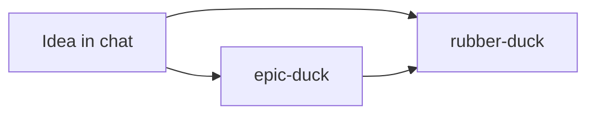

# Agent skills (Pappa)

Personal agent skills for software engineering — heavily influenced by (like, copied from) [Matt Pocock's skills](https://github.com/mattpocock/skills), rewritten for my workflow.

## Use in this repo

Skills live in **`.cursor/skills/`**. Open this repository in Cursor and invoke with `/skill-name` or attach the skill in chat — no symlink needed while iterating here.

## Use in other repos

Symlink individual skills (or the whole folder) into `~/.cursor/skills/`:

```bash
ln -sfn "$(pwd)/.cursor/skills/rubber-duck" ~/.cursor/skills/rubber-duck
```

## Per-repo setup

Planning skills expect `docs/agents/backlog.md` (and usually `domain.md`). Run once per repository:

```
/setup-duck-skills
```

Supports GitHub, GitLab, Azure DevOps Boards, local markdown, or a custom tracker.

## Skills catalog

| Skill | Invocation | Purpose |
|-------|------------|---------|
| `setup-duck-skills` | Explicit | Configure tracker, domain docs, optional ticket labels |
| `rubber-duck` | Explicit | Design interview + glossary/ADR updates (`interrogate` + `software-design`) |
| `interrogate` | Auto-suggested | Round-based design interview |
| `software-design` | Auto-suggested | Glossary and ADR updates while designing |
| `3-amigos` | Auto-suggested | Backlog ticket quality (fit, clarity, ISO 24495, INVEST) before publish |
| `spike` | Auto-suggested | Time-boxed investigation; findings as Markdown in the repo |
| `epic-duck` | Explicit | Large foggy efforts → feature + decision issues on tracker |

## Typical planning flow



- **Clear enough to discuss**: `rubber-duck` (terms and ADRs as you decide)
- **Large or foggy**: `epic-duck` to chart a feature, then `rubber-duck` on individual issues

## Roadmap

Planned next batches: build (`implement`, `tdd`), quality (`code-review`, `diagnosing-bugs`), ship (`pr`, CI loop).
